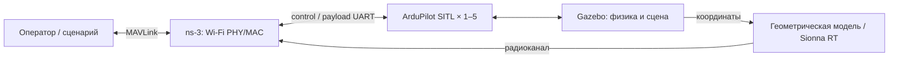

# BAS v2 — стенд моделирования беспилотных авиационных систем

Совместное моделирование полёта группы БАС и её радиосети на одном Linux-хосте.
Gazebo рассчитывает физику и среду, ArduPilot SITL управляет аппаратами,
ns-3 моделирует передачу пакетов, а геометрическая модель или Sionna RT —
распространение радиосигнала.

Стенд предназначен для разработки и проверки сценариев группового полёта,
обмена командами, ретрансляции, полезной нагрузки и воздействия помех.

[Запуск](#запуск) · [Руководство](docs/runtime.md) · [Конфигурации](#конфигурации)
· [Проверенное состояние](#проверенное-состояние) · [Публикации](#публикации)

## Возможности

- **Группа из 1–5 БАС:** физика Gazebo, автопилоты ArduPilot SITL, маршруты,
  взлёт и посадка.
- **Общая радиосеть:** native Wi-Fi PHY/MAC ns-3, очереди, повторные передачи
  и конкуренция за эфир.
- **Два потока на аппарат:** команды и телеметрия через `control`,
  полезная нагрузка через `payload`, с эмуляцией скорости UART.
- **Среда распространения:** геометрическая модель или Sionna RT;
  общая геометрия зданий и рельефа для физики и радиорасчёта.
- **Помехи и ретрансляция:** настраиваемые источники радиопомех,
  политики `fixed` и `failover`, заданная нагрузка на канал.
- **Управление опытом:** CLI, локальный веб-интерфейс, последовательные серии
  запусков, журналы и раздельная оценка выполнения миссии и качества измерений.

## Как устроен стенд



Состав аппаратов, сцена, модель распространения, потоки и условия опыта
задаются в JSON/YAML. Для изменения маршрутов и параметров радио достаточно
подготовить свою конфигурацию.

## Запуск

Полный стенд работает на **Linux x86-64 с Docker**. Для CUDA-варианта Sionna RT
нужны NVIDIA GPU, драйвер и NVIDIA Container Toolkit.
На Windows доступны редактирование и проверка конфигураций, а также интерфейс оператора.

```bash
git clone https://github.com/AFETZ/bas_v2.git
cd bas_v2
```

Перед первым полётом подготовьте закреплённый Docker-образ, Python-зависимости
и native runtime по [руководству по установке](docs/runtime.md#зависимости-и-разработка).
Образы, зависимости и журналы хранятся отдельно от исходников.

На подготовленном хосте:

```bash
python3 bas.py inspect --config runtime-link-test.json
python3 bas.py run --config runtime-link-test.json --run-id link-test-01
```

Каждому новому опыту задавайте новый `--run-id`. Подготовка, взлёт и посадка
выполняются отдельно от измерительного окна, заданного в конфигурации.

Для работы через браузер:

```bash
python3 bas.py ui --port 8765
```

Откройте **http://127.0.0.1:8765/**. Интерфейс позволяет редактировать и проверять
конфигурацию, запускать и останавливать опыт, просматривать состояние и скачивать
артефакты. При работе с удалённым хостом используйте
[SSH-туннель](docs/runtime.md#запуск-на-подготовленном-хосте).

## Конфигурации

| Файл | Назначение |
|---|---|
| [runtime.json](runtime.json) | Базовый городской сценарий: 5 БАС, геометрическая радиомодель, два потока |
| [runtime-link-test.json](runtime-link-test.json) | Короткий опыт связи: 20 с измерений, 10 кбит/с полезной нагрузки на каждый БАС |
| [runtime-terrain.json](runtime-terrain.json) | 5 БАС, рельеф 10×10 км, full-mesh Sionna RT и направленный источник помех; требует подготовки terrain bundle |

Настройки маршрутов, радио и источников находятся в [network/config/](network/config/).
Добавление заданной нагрузки в RT-сценарий, генерация рельефа и анализ результатов
описаны в [руководстве](docs/runtime.md).

## Проверенное состояние

В рабочую версию включены исправления с ПК4 до
[`a6285c8`](https://github.com/AFETZ/bas_v2/commit/a6285c8d63e90c05a86c88a19bcf1687c2c56bde).

10 ноября 2026 года сочетание **5 БАС + рельеф + Sionna RT + помеха +
10 кбит/с нагрузки на БАС** прошло три последовательных полётных цикла.
Все три получили `completed / succeeded / valid`; максимальный возраст
применённого состояния составил **87,4 / 88,8 / 92,4 мс** при лимите 100 мс.

Это результаты коротких измерительных окон по 20 секунд на ПК4.
Многочасовая устойчивость, установка текущей версии на чистую машину,
аппаратная приёмка и соответствие реальному модему требуют отдельных проверок.
В двух из трёх запусков финальное радиоподтверждение посадки UAV5 не наблюдалось,
при подтверждённых посадке и разоружении по бортовому UART.

Условия, идентификаторы запусков, тесты и открытые пункты:
[план и результаты проверки](plans/customer-delivery.md).

## Исходники и документация

| Каталог / файл | Содержание |
|---|---|
| [bas.py](bas.py) | CLI и управление жизненным циклом опыта |
| [web/](web/) | Локальный интерфейс оператора |
| [src/](src/) | ROS-пакет, модели аппаратов и Gazebo |
| [network/](network/) | Радиосеть, координация, UART-адаптеры и отслеживание состояния |
| [scripts/product/](scripts/product/) | Подготовка среды, сценариев и анализ результатов |
| [tests/](tests/) | Модульные и программные интеграционные проверки |
| [docs/runtime.md](docs/runtime.md) | Полное руководство: запуск, RT, помехи, нагрузка, результаты и установка |

В подготовленном runtime-окружении тесты запускаются командой
`python3 -m unittest discover -s tests`.
Результаты опытов записываются в `runs/`, зависимости и собранные компоненты —
в `.external/`, `build/` и `install/`; эти каталоги исключены из Git.

## Публикации

На основе стенда подготовлена статья о передаче команд и маршрутах группы БПЛА
при смене ретранслятора в застроенной среде. Её исходные данные и воспроизводимый
пакет закреплены отдельно:

- [Релиз статьи v7: архивы журналов и среды](https://github.com/AFETZ/bas_v2/releases/tag/urban-article-v7-20261104).
- [Инструкция по воспроизведению статьи](https://github.com/AFETZ/bas_v2/blob/ed260ca9de57bb76df4de5baa8471a651814d499/README.md).

Для разработки и новых сценариев используется ветка `main`.
Для воспроизведения опубликованных результатов используется закреплённый пакет статьи.

## Лицензия

Исходники распространяются под [GPL-3.0](LICENSE).
Сторонние компоненты сохраняют собственные лицензии.
